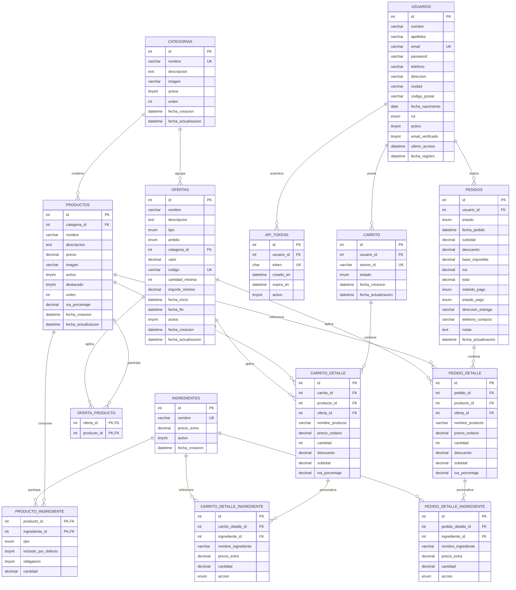

# Base de datos **StarBites** — Documento técnico y de diseño

> Proyecto 1 · Aplicación web de restauración  
> Ciclo Formativo de Grado Superior — Desarrollo de Aplicaciones Web  
> Base de datos: `daw2mvc` · Motor: MySQL 8+ / MariaDB 10.5+ · Contenedor Docker

---

## Índice

1. [Resumen ejecutivo](#1-resumen-ejecutivo)
2. [Requisitos del proyecto que afectan a la base de datos](#2-requisitos-del-proyecto-que-afectan-a-la-base-de-datos)
3. [Decisiones de diseño](#3-decisiones-de-diseño)
4. [Diagrama entidad-relación](#4-diagrama-entidad-relación)
5. [Modelo relacional](#5-modelo-relacional)
6. [Diccionario de datos](#6-diccionario-de-datos)
7. [Integridad referencial y reglas de negocio](#7-integridad-referencial-y-reglas-de-negocio)
8. [Normalización](#8-normalización)
9. [Índices y rendimiento](#9-índices-y-rendimiento)
10. [Datos iniciales](#10-datos-iniciales)
11. [Seguridad](#11-seguridad)
12. [Operaciones y consultas clave](#12-operaciones-y-consultas-clave)
13. [Correspondencia requisitos ↔ base de datos](#13-correspondencia-requisitos--base-de-datos)
14. [Despliegue e importación](#14-despliegue-e-importación)
15. [Ampliaciones futuras](#15-ampliaciones-futuras)
16. [Conclusiones](#16-conclusiones)
17. [Anexo A — Credenciales de prueba](#anexo-a--credenciales-de-prueba)
18. [Anexo B — Consultas útiles](#anexo-b--consultas-útiles)

---

## 1. Resumen ejecutivo

La base de datos `daw2mvc` da soporte a una aplicación web de restauración temática **StarBites**. Cubre el ciclo completo de negocio:

- Registro e inicio de sesión de usuarios con roles (`usuario` / `admin`).
- Catálogo de 6 categorías y 36 productos, con imagen, precio, IVA, estado y destacados.
- Ingredientes **base** (incluidos en el plato) e **ingredientes extra** (opcionales, con sobrecoste).
- Carrito persistente, válido tanto para invitados (por `sesion_id`) como para usuarios autenticados.
- Ofertas de cuatro tipos: descuento, 2x1, combo y código promocional, con ámbito producto/categoría/pedido y mínimos de cantidad o importe.
- Pedidos con desglose de subtotal, descuento, base imponible, IVA y total; líneas de pedido con instantáneas de nombre y precio.
- Historial de pedidos por usuario y datos suficientes para el panel de administración.
- Tokens de API para el panel de administración asíncrono.

**Volumen inicial:** 6 categorías, 36 productos, 139 ingredientes (39 extras + 100 bases), 229 relaciones producto–ingrediente, 7 ofertas, 2 usuarios y 2 pedidos de ejemplo.

---

## 2. Requisitos del proyecto que afectan a la base de datos

Extraídos del enunciado *“Proyecto 1 Restaurante (App Web)”*:

| Requisito del enunciado | Cobertura en la base de datos |
|---|---|
| Registro e inicio de sesión con sesiones PHP | Tabla `usuarios` con email único, contraseña hash y rol. |
| Consultar y seleccionar productos | Tablas `categorias`, `productos`. |
| Carrito: consultar, modificar y eliminar productos | Tablas `carrito`, `carrito_detalle`, `carrito_detalle_ingrediente`. |
| Solo finalizar compra con sesión iniciada | `pedidos.usuario_id` obligatorio y FK a `usuarios`. |
| Añadir o eliminar ingredientes modificando el precio | `ingredientes`, `producto_ingrediente` (`base`/`extra`), `precio_extra`, y detalle de ingredientes en carrito/pedido. |
| Consultar ofertas y añadirlas al carrito | `ofertas`, `oferta_producto`, `carrito_detalle.oferta_id`. |
| Ofertas por cantidad determinada de productos | `ofertas.cantidad_minima` e `importe_minimo`. |
| Consultar el último pedido al volver a entrar | `pedidos` + `pedido_detalle` + `pedido_detalle_ingrediente`. |
| Panel de administración asíncrono (API PHP) | `api_tokens`, `pedidos.estado`, `productos.activo`, índices de filtrado. |
| Listar, modificar y ordenar productos y pedidos | Campos de estado, orden, fechas e índices. |
| Añadir/eliminar productos de un pedido y modificar precio | `pedido_detalle` editable + totales en `pedidos`. |
| Filtrar por nombre, ID, precio, etc. | Índices sobre `productos.nombre`, `productos.precio`, `pedidos.id`, `pedidos.fecha_pedido`, `pedidos.estado`. |
| Listar usuarios e historial de pedidos | `usuarios` + `pedidos.usuario_id`. |
| Compra con precio e impuestos | `pedidos.base_imponible`, `pedidos.iva`, `pedidos.total`; IVA por producto y por línea. |
| Base de datos en contenedor Docker | `compose.yaml` con MySQL en el puerto 3307. |
| Diagramas E-R y relacional en la memoria | Se incluyen en este documento (sección 4 y 5). |

---

## 3. Decisiones de diseño

### 3.1 Separación entre catálogo, carrito y pedido

Se utilizan tres bloques independientes:

- **Catálogo:** `categorias`, `productos`, `ingredientes`, `producto_ingrediente`.
- **Carrito:** `carrito`, `carrito_detalle`, `carrito_detalle_ingrediente` (datos mutables).
- **Pedido:** `pedidos`, `pedido_detalle`, `pedido_detalle_ingrediente` (datos históricos).

Esta separación evita que modificar un producto del catálogo altere pedidos ya realizados y permite que el carrito exista antes de que el usuario inicie sesión.

### 3.2 Instantáneas (*snapshots*) en las líneas de pedido

`pedido_detalle` guarda `nombre_producto` y `precio_unitario`, y `pedido_detalle_ingrediente` guarda `nombre_ingrediente` y `precio_extra`. No son meras duplicaciones: son **copias históricas** necesarias para que un pedido antiguo siga siendo legible aunque el producto se renombre, cambie de precio o se elimine. Por eso las FK de producto/ingrediente usan `ON DELETE SET NULL`.

### 3.3 Ingredientes base frente a extras

`producto_ingrediente` distingue:

- `tipo = 'base'`: ingrediente incluido en el plato. `incluido_por_defecto = 1`, `precio_extra = 0`. El usuario puede **quitarlo**.
- `tipo = 'extra'`: ingrediente opcional. `incluido_por_defecto = 0`, con `precio_extra > 0`. El usuario puede **añadirlo**.

Así se cumple el requisito de “añadir o eliminar ingredientes” sin ambigüedad y se puede recalcular el precio sumando solo los extras.

### 3.4 Ofertas flexibles

La tabla `ofertas` incorpora:

- `tipo`: `descuento`, `2x1`, `combo`, `codigo`.
- `ambito`: `producto`, `categoria` o `pedido`.
- `categoria_id`: solo para ofertas de categoría.
- `oferta_producto`: relación N:M para ofertas de producto.
- `cantidad_minima` e `importe_minimo`: requisitos de aplicación.
- `codigo`: para promociones canjeables.
- Vigencia mediante `fecha_inicio`, `fecha_fin` y `activa`.

### 3.5 IVA desglosado

Los precios de carta se interpretan como **PVP con IVA incluido**. Para poder generar un desglose correcto:

- `productos.iva_porcentaje` (10 % comida, 21 % bebidas).
- `carrito_detalle.iva_porcentaje` y `pedido_detalle.iva_porcentaje`.
- `pedidos.base_imponible`, `pedidos.iva` y `pedidos.total`.

Fórmula aplicada a cada línea:

```text
base_imponible = total_línea / (1 + iva_porcentaje / 100)
iva            = total_línea - base_imponible
```

### 3.6 Carrito para invitados y usuarios

`carrito.sesion_id` es único y obligatorio; `carrito.usuario_id` es opcional. El flujo previsto es:

1. El invitado recibe un `sesion_id` (por ejemplo, el ID de sesión de PHP).
2. Al iniciar sesión, el carrito se asocia al usuario y, si ya tenía otro, se fusionan.
3. Al confirmar la compra, el carrito pasa a `estado = 'convertido'` y se crea el pedido.

### 3.7 Borrado lógico

Productos, categorías, ingredientes y usuarios tienen el campo `activo`. El borrado físico se reserva para casos excepcionales. Esto protege el historial de pedidos y evita romper FK.

### 3.8 Políticas de borrado

| Relación | Política | Motivo |
|---|---|---|
| `productos → categorias` | `RESTRICT` | No eliminar una categoría con productos. |
| `producto_ingrediente → productos` | `CASCADE` | La relación desaparece con el producto. |
| `producto_ingrediente → ingredientes` | `RESTRICT` | No eliminar un ingrediente en uso. |
| `ofertas → categorias` | `SET NULL` | La oferta puede quedar sin categoría. |
| `pedidos → usuarios` | `RESTRICT` | Conservar historial; usar `activo = 0`. |
| `pedido_detalle → pedidos` | `CASCADE` | El detalle no existe sin el pedido. |
| `pedido_detalle → productos` | `SET NULL` | Conservar la línea histórica. |
| `carrito* → ...` | `CASCADE` / `SET NULL` | El carrito es efímero. |

---

## 4. Diagrama entidad-relación



---

## 5. Modelo relacional

```text
USUARIOS(
  id PK,
  nombre, apellidos, email UK, password, telefono, direccion,
  ciudad, codigo_postal, fecha_nacimiento, rol, activo,
  email_verificado, ultimo_acceso, fecha_registro
)

CATEGORIAS(
  id PK, nombre UK, descripcion, imagen, activa, orden,
  fecha_creacion, fecha_actualizacion
)

PRODUCTOS(
  id PK, categoria_id FK → CATEGORIAS.id,
  nombre, descripcion, precio, imagen, activo, destacado,
  orden, iva_porcentaje, fecha_creacion, fecha_actualizacion
)

INGREDIENTES(
  id PK, nombre UK, precio_extra, activo, fecha_creacion
)

PRODUCTO_INGREDIENTE(
  producto_id PK FK → PRODUCTOS.id,
  ingrediente_id PK FK → INGREDIENTES.id,
  tipo, incluido_por_defecto, obligatorio, cantidad
)

OFERTAS(
  id PK, nombre, descripcion, tipo, ambito,
  categoria_id FK → CATEGORIAS.id,
  valor, codigo UK, cantidad_minima, importe_minimo,
  fecha_inicio, fecha_fin, activa, fecha_creacion, fecha_actualizacion
)

OFERTA_PRODUCTO(
  oferta_id PK FK → OFERTAS.id,
  producto_id PK FK → PRODUCTOS.id
)

API_TOKENS(
  id PK, usuario_id FK → USUARIOS.id,
  token UK, creado_en, expira_en, activo
)

CARRITO(
  id PK, usuario_id FK → USUARIOS.id,
  sesion_id UK, estado, fecha_creacion, fecha_actualizacion
)

CARRITO_DETALLE(
  id PK, carrito_id FK → CARRITO.id,
  producto_id FK → PRODUCTOS.id,
  oferta_id FK → OFERTAS.id,
  nombre_producto, precio_unitario, cantidad,
  descuento, subtotal, iva_porcentaje
)

CARRITO_DETALLE_INGREDIENTE(
  id PK, carrito_detalle_id FK → CARRITO_DETALLE.id,
  ingrediente_id FK → INGREDIENTES.id,
  nombre_ingrediente, precio_extra, cantidad, accion
)

PEDIDOS(
  id PK, usuario_id FK → USUARIOS.id,
  estado, fecha_pedido, subtotal, descuento,
  base_imponible, iva, total, metodo_pago, estado_pago,
  direccion_entrega, telefono_contacto, notas, fecha_actualizacion
)

PEDIDO_DETALLE(
  id PK, pedido_id FK → PEDIDOS.id,
  producto_id FK → PRODUCTOS.id,
  oferta_id FK → OFERTAS.id,
  nombre_producto, precio_unitario, cantidad,
  descuento, subtotal, iva_porcentaje
)

PEDIDO_DETALLE_INGREDIENTE(
  id PK, pedido_detalle_id FK → PEDIDO_DETALLE.id,
  ingrediente_id FK → INGREDIENTES.id,
  nombre_ingrediente, precio_extra, cantidad, accion
)
```

---

## 6. Diccionario de datos

### 6.1 `usuarios`

| Columna | Tipo | Nulo | Clave / defecto | Descripción |
|---|---|---|---|---|
| `id` | INT | No | PK, AUTO_INCREMENT | Identificador. |
| `nombre` | VARCHAR(100) | No | — | Nombre. |
| `apellidos` | VARCHAR(150) | Sí | NULL | Apellidos. |
| `email` | VARCHAR(150) | No | UNIQUE | Correo de acceso. |
| `password` | VARCHAR(255) | No | — | Hash bcrypt (`password_hash`). |
| `telefono` | VARCHAR(20) | Sí | NULL | Teléfono. |
| `direccion` | VARCHAR(255) | Sí | NULL | Dirección. |
| `ciudad` | VARCHAR(100) | Sí | NULL | Ciudad. |
| `codigo_postal` | VARCHAR(10) | Sí | NULL | Código postal. |
| `fecha_nacimiento` | DATE | Sí | NULL | Fecha de nacimiento. |
| `rol` | ENUM('usuario','admin') | No | 'usuario' | Rol de acceso. |
| `activo` | TINYINT(1) | No | 1 | Borrado lógico. |
| `email_verificado` | TINYINT(1) | No | 0 | Verificación de correo. |
| `ultimo_acceso` | DATETIME | Sí | NULL | Último login. |
| `fecha_registro` | DATETIME | No | CURRENT_TIMESTAMP | Alta. |

Índices: `uq_usuarios_email`, `idx_usuarios_rol`, `idx_usuarios_activo`.  
CHECK: `rol IN ('usuario','admin')`.

### 6.2 `categorias`

| Columna | Tipo | Nulo | Clave / defecto | Descripción |
|---|---|---|---|---|
| `id` | INT | No | PK, AI | Identificador. |
| `nombre` | VARCHAR(100) | No | UNIQUE | Nombre visible. |
| `descripcion` | TEXT | Sí | NULL | Texto descriptivo. |
| `imagen` | VARCHAR(255) | Sí | NULL | Ruta de imagen. |
| `activa` | TINYINT(1) | No | 1 | Visible en la web. |
| `orden` | INT | No | 0 | Orden de presentación. |
| `fecha_creacion` | DATETIME | No | CURRENT_TIMESTAMP | Alta. |
| `fecha_actualizacion` | DATETIME | No | CURRENT_TIMESTAMP ON UPDATE | Última modificación. |

Índice: `idx_categorias_activa_orden (activa, orden)`.

### 6.3 `productos`

| Columna | Tipo | Nulo | Clave / defecto | Descripción |
|---|---|---|---|---|
| `id` | INT | No | PK, AI | Identificador. |
| `categoria_id` | INT | No | FK → `categorias.id` | Categoría. |
| `nombre` | VARCHAR(150) | No | — | Nombre del plato. |
| `descripcion` | TEXT | Sí | NULL | Descripción. |
| `precio` | DECIMAL(10,2) | No | — | PVP con IVA. |
| `imagen` | VARCHAR(255) | Sí | NULL | Ruta relativa. |
| `activo` | TINYINT(1) | No | 1 | Disponible. |
| `destacado` | TINYINT(1) | No | 0 | Producto popular. |
| `orden` | INT | No | 0 | Orden de carta. |
| `iva_porcentaje` | DECIMAL(5,2) | No | 10.00 | 10 % comida / 21 % bebida. |
| `fecha_creacion` | DATETIME | No | CURRENT_TIMESTAMP | Alta. |
| `fecha_actualizacion` | DATETIME | No | CURRENT_TIMESTAMP ON UPDATE | Modificación. |

Índices: `(categoria_id, activo)`, `nombre`, `precio`, `(destacado, activo)`.  
CHECK: `precio >= 0`, `iva_porcentaje >= 0`.

### 6.4 `ingredientes`

| Columna | Tipo | Nulo | Clave / defecto | Descripción |
|---|---|---|---|---|
| `id` | INT | No | PK, AI | Identificador. |
| `nombre` | VARCHAR(100) | No | UNIQUE | Nombre. |
| `precio_extra` | DECIMAL(10,2) | No | 0.00 | Sobrecoste; 0 en bases. |
| `activo` | TINYINT(1) | No | 1 | Disponible. |
| `fecha_creacion` | DATETIME | No | CURRENT_TIMESTAMP | Alta. |

Índice: `idx_ingredientes_activo`. CHECK: `precio_extra >= 0`.

### 6.5 `producto_ingrediente`

| Columna | Tipo | Nulo | Clave / defecto | Descripción |
|---|---|---|---|---|
| `producto_id` | INT | No | PK, FK → `productos.id` | Producto. |
| `ingrediente_id` | INT | No | PK, FK → `ingredientes.id` | Ingrediente. |
| `tipo` | ENUM('base','extra') | No | 'extra' | Base incluida o extra opcional. |
| `incluido_por_defecto` | TINYINT(1) | No | 0 | Se sirve de serie. |
| `obligatorio` | TINYINT(1) | No | 0 | No se puede quitar. |
| `cantidad` | DECIMAL(10,2) | No | 1.00 | Cantidad de referencia. |

Índices: `idx_pi_ingrediente`, `idx_pi_producto_tipo`. CHECK: `cantidad > 0`.

### 6.6 `ofertas`

| Columna | Tipo | Nulo | Clave / defecto | Descripción |
|---|---|---|---|---|
| `id` | INT | No | PK, AI | Identificador. |
| `nombre` | VARCHAR(150) | No | — | Nombre comercial. |
| `descripcion` | TEXT | Sí | NULL | Condiciones. |
| `tipo` | ENUM('descuento','2x1','combo','codigo') | No | — | Mecánica. |
| `ambito` | ENUM('producto','categoria','pedido') | No | 'producto' | Alcance. |
| `categoria_id` | INT | Sí | FK → `categorias.id` | Categoría si aplica. |
| `valor` | DECIMAL(10,2) | Sí | NULL | % o importe. |
| `codigo` | VARCHAR(50) | Sí | UNIQUE | Código canjeable. |
| `cantidad_minima` | INT | No | 1 | Mínimo de unidades. |
| `importe_minimo` | DECIMAL(10,2) | No | 0.00 | Mínimo de compra. |
| `fecha_inicio` | DATETIME | No | — | Inicio de vigencia. |
| `fecha_fin` | DATETIME | Sí | NULL | Fin de vigencia. |
| `activa` | TINYINT(1) | No | 1 | Estado. |
| `fecha_creacion` | DATETIME | No | CURRENT_TIMESTAMP | Alta. |
| `fecha_actualizacion` | DATETIME | No | CURRENT_TIMESTAMP ON UPDATE | Modificación. |

Índices: `uq_ofertas_codigo`, `idx_ofertas_vigencia`, `idx_ofertas_ambito`.  
CHECK: valor/importe/cantidad y coherencia de fechas.

### 6.7 `oferta_producto`

| Columna | Tipo | Nulo | Clave | Descripción |
|---|---|---|---|---|
| `oferta_id` | INT | No | PK, FK → `ofertas.id` | Oferta. |
| `producto_id` | INT | No | PK, FK → `productos.id` | Producto incluido. |

### 6.8 `api_tokens`

| Columna | Tipo | Nulo | Clave / defecto | Descripción |
|---|---|---|---|---|
| `id` | INT | No | PK, AI | Identificador. |
| `usuario_id` | INT | No | FK → `usuarios.id` | Usuario autenticado. |
| `token` | CHAR(64) | No | UNIQUE | Hash SHA-256 del token. |
| `creado_en` | DATETIME | No | CURRENT_TIMESTAMP | Emisión. |
| `expira_en` | DATETIME | No | — | Caducidad. |
| `activo` | TINYINT(1) | No | 1 | Revocación. |

Índices: `uq_api_tokens_token`, `idx_api_tokens_usuario`, `idx_api_tokens_expira`.

### 6.9 `carrito`

| Columna | Tipo | Nulo | Clave / defecto | Descripción |
|---|---|---|---|---|
| `id` | INT | No | PK, AI | Identificador. |
| `usuario_id` | INT | Sí | FK → `usuarios.id` | Usuario (NULL si invitado). |
| `sesion_id` | VARCHAR(128) | No | UNIQUE | Identificador de sesión. |
| `estado` | ENUM('activo','convertido','abandonado') | No | 'activo' | Ciclo de vida. |
| `fecha_creacion` | DATETIME | No | CURRENT_TIMESTAMP | Alta. |
| `fecha_actualizacion` | DATETIME | No | CURRENT_TIMESTAMP ON UPDATE | Modificación. |

### 6.10 `carrito_detalle`

| Columna | Tipo | Nulo | Clave / defecto | Descripción |
|---|---|---|---|---|
| `id` | INT | No | PK, AI | Identificador. |
| `carrito_id` | INT | No | FK → `carrito.id` | Carrito. |
| `producto_id` | INT | Sí | FK → `productos.id` | Producto. |
| `oferta_id` | INT | Sí | FK → `ofertas.id` | Oferta aplicada. |
| `nombre_producto` | VARCHAR(150) | No | — | Instantánea del nombre. |
| `precio_unitario` | DECIMAL(10,2) | No | — | PVP con IVA. |
| `cantidad` | INT | No | 1 | Unidades. |
| `descuento` | DECIMAL(10,2) | No | 0.00 | Descuento de línea. |
| `subtotal` | DECIMAL(10,2) | No | — | Base + extras − descuento. |
| `iva_porcentaje` | DECIMAL(5,2) | No | 10.00 | IVA de la línea. |

### 6.11 `carrito_detalle_ingrediente`

| Columna | Tipo | Nulo | Clave / defecto | Descripción |
|---|---|---|---|---|
| `id` | INT | No | PK, AI | Identificador. |
| `carrito_detalle_id` | INT | No | FK → `carrito_detalle.id` | Línea. |
| `ingrediente_id` | INT | Sí | FK → `ingredientes.id` | Ingrediente. |
| `nombre_ingrediente` | VARCHAR(100) | No | — | Instantánea. |
| `precio_extra` | DECIMAL(10,2) | No | 0.00 | Sobrecoste. |
| `cantidad` | DECIMAL(10,2) | No | 1.00 | Cantidad. |
| `accion` | ENUM('incluido','quitado','añadido') | No | 'incluido' | Operación. |

### 6.12 `pedidos`

| Columna | Tipo | Nulo | Clave / defecto | Descripción |
|---|---|---|---|---|
| `id` | INT | No | PK, AI | Número de pedido. |
| `usuario_id` | INT | No | FK → `usuarios.id` | Cliente. |
| `estado` | ENUM(...) | No | 'pendiente' | Estado del pedido. |
| `fecha_pedido` | DATETIME | No | CURRENT_TIMESTAMP | Fecha. |
| `subtotal` | DECIMAL(10,2) | No | — | Suma de líneas. |
| `descuento` | DECIMAL(10,2) | No | 0.00 | Descuento global. |
| `base_imponible` | DECIMAL(10,2) | No | 0.00 | Base sin IVA. |
| `iva` | DECIMAL(10,2) | No | 0.00 | Cuota de IVA. |
| `total` | DECIMAL(10,2) | No | — | Total cobrado. |
| `metodo_pago` | ENUM(...) | No | 'simulado' | Método. |
| `estado_pago` | ENUM(...) | No | 'pendiente' | Estado del cobro. |
| `direccion_entrega` | VARCHAR(255) | Sí | NULL | Dirección. |
| `telefono_contacto` | VARCHAR(20) | Sí | NULL | Teléfono. |
| `notas` | TEXT | Sí | NULL | Observaciones. |
| `fecha_actualizacion` | DATETIME | No | CURRENT_TIMESTAMP ON UPDATE | Modificación. |

Estados: `pendiente`, `confirmado`, `preparando`, `enviado`, `entregado`, `cancelado`.  
Pago: `pendiente`, `pagado`, `fallido`, `reembolsado`.  
Método: `simulado`, `tarjeta`, `efectivo`, `paypal`, `transferencia`.

Índices: `(usuario_id, fecha_pedido)`, `estado`, `fecha_pedido`, `estado_pago`.

### 6.13 `pedido_detalle`

| Columna | Tipo | Nulo | Clave / defecto | Descripción |
|---|---|---|---|---|
| `id` | INT | No | PK, AI | Identificador. |
| `pedido_id` | INT | No | FK → `pedidos.id` | Pedido. |
| `producto_id` | INT | Sí | FK → `productos.id` | Producto original. |
| `oferta_id` | INT | Sí | FK → `ofertas.id` | Oferta aplicada. |
| `nombre_producto` | VARCHAR(150) | No | — | Instantánea. |
| `precio_unitario` | DECIMAL(10,2) | No | — | Precio histórico. |
| `cantidad` | INT | No | — | Unidades. |
| `descuento` | DECIMAL(10,2) | No | 0.00 | Descuento de línea. |
| `subtotal` | DECIMAL(10,2) | No | — | Total de línea con extras. |
| `iva_porcentaje` | DECIMAL(5,2) | No | 10.00 | IVA histórico. |

### 6.14 `pedido_detalle_ingrediente`

| Columna | Tipo | Nulo | Clave / defecto | Descripción |
|---|---|---|---|---|
| `id` | INT | No | PK, AI | Identificador. |
| `pedido_detalle_id` | INT | No | FK → `pedido_detalle.id` | Línea. |
| `ingrediente_id` | INT | Sí | FK → `ingredientes.id` | Ingrediente original. |
| `nombre_ingrediente` | VARCHAR(100) | No | — | Instantánea. |
| `precio_extra` | DECIMAL(10,2) | No | 0.00 | Sobrecoste histórico. |
| `cantidad` | DECIMAL(10,2) | No | 1.00 | Cantidad. |
| `accion` | ENUM('incluido','quitado','añadido') | No | 'incluido' | Operación. |

---

## 7. Integridad referencial y reglas de negocio

### 7.1 Claves foráneas

| Tabla | Columna | Referencia | ON DELETE | ON UPDATE |
|---|---|---|---|---|
| `productos` | `categoria_id` | `categorias.id` | RESTRICT | CASCADE |
| `producto_ingrediente` | `producto_id` | `productos.id` | CASCADE | — |
| `producto_ingrediente` | `ingrediente_id` | `ingredientes.id` | RESTRICT | — |
| `ofertas` | `categoria_id` | `categorias.id` | SET NULL | CASCADE |
| `oferta_producto` | `oferta_id` | `ofertas.id` | CASCADE | — |
| `oferta_producto` | `producto_id` | `productos.id` | CASCADE | — |
| `api_tokens` | `usuario_id` | `usuarios.id` | CASCADE | — |
| `carrito` | `usuario_id` | `usuarios.id` | CASCADE | — |
| `carrito_detalle` | `carrito_id` | `carrito.id` | CASCADE | — |
| `carrito_detalle` | `producto_id` | `productos.id` | SET NULL | — |
| `carrito_detalle` | `oferta_id` | `ofertas.id` | SET NULL | — |
| `carrito_detalle_ingrediente` | `carrito_detalle_id` | `carrito_detalle.id` | CASCADE | — |
| `carrito_detalle_ingrediente` | `ingrediente_id` | `ingredientes.id` | SET NULL | — |
| `pedidos` | `usuario_id` | `usuarios.id` | RESTRICT | — |
| `pedido_detalle` | `pedido_id` | `pedidos.id` | CASCADE | — |
| `pedido_detalle` | `producto_id` | `productos.id` | SET NULL | — |
| `pedido_detalle` | `oferta_id` | `ofertas.id` | SET NULL | — |
| `pedido_detalle_ingrediente` | `pedido_detalle_id` | `pedido_detalle.id` | CASCADE | — |
| `pedido_detalle_ingrediente` | `ingrediente_id` | `ingredientes.id` | SET NULL | — |

### 7.2 Reglas de negocio garantizadas por la base de datos

1. Un email solo puede pertenecer a un usuario.
2. No puede existir un pedido sin usuario.
3. No se puede borrar un usuario con pedidos (se desactiva con `activo = 0`).
4. No se puede borrar una categoría con productos.
5. No se puede borrar un ingrediente que forme parte de un producto.
6. Un producto no puede pertenecer a una categoría inexistente.
7. Un pedido no puede tener líneas con cantidad cero o negativa.
8. Los precios, descuentos, subtotales e IVA no pueden ser negativos.
9. Una oferta no puede terminar antes de empezar.
10. Una oferta debe tener cantidad mínima ≥ 1.
11. Un carrito tiene un único `sesion_id`.
12. Un ingrediente no puede repetirse en el mismo producto (PK compuesta).

### 7.3 Reglas que se validan en la aplicación (no en SQL)

- Que la suma de líneas coincida con `subtotal`, `descuento`, `iva` y `total`.
- Que el descuento no supere el subtotal.
- Que las ofertas estén vigentes y cumplan mínimos.
- Que un usuario solo vea sus propios pedidos.
- Que un administrador no pueda eliminarse a sí mismo.
- Que las contraseñas cumplan una política mínima.

---

## 8. Normalización

### 8.1 Primera forma normal (1FN)

Todos los atributos son atómicos. No hay listas ni campos multivaluados: los ingredientes y las líneas de pedido se modelan en tablas independientes.

### 8.2 Segunda forma normal (2FN)

- `producto_ingrediente` tiene PK compuesta `(producto_id, ingrediente_id)`; el resto de atributos dependen de la combinación completa.
- `oferta_producto` tiene PK compuesta `(oferta_id, producto_id)`; no hay atributos parcialmente dependientes.

### 8.3 Tercera forma normal (3FN)

No existen dependencias transitivas en el catálogo:

- `productos.categoria_id` referencia la categoría; el nombre de la categoría no se duplica.
- `productos` no almacena datos del usuario.
- `pedidos` no almacena datos personales del usuario; se referencian por `usuario_id` (y se copian solo los datos de entrega necesarios).

### 8.4 Desnormalización justificada

Las líneas de pedido y carrito guardan **instantáneas** (`nombre_producto`, `precio_unitario`, `nombre_ingrediente`, `precio_extra`) para preservar el histórico. Es una desnormalización deliberada, no un error de diseño: si el precio del producto cambia mañana, el pedido antiguo debe seguir mostrando el precio pagado.

También se guarda `iva_porcentaje` en la línea para poder reconstruir el desglose fiscal aunque el tipo de IVA cambie en el futuro.

---

## 9. Índices y rendimiento

| Índice | Tabla | Uso |
|---|---|---|
| `uq_usuarios_email` | `usuarios` | Login y unicidad. |
| `idx_usuarios_rol` | `usuarios` | Filtro de administradores. |
| `idx_categorias_activa_orden` | `categorias` | Carta ordenada. |
| `idx_productos_categoria_activo` | `productos` | Listado por categoría. |
| `idx_productos_nombre` | `productos` | Búsqueda y orden por nombre. |
| `idx_productos_precio` | `productos` | Filtro/orden por precio. |
| `idx_productos_destacado` | `productos` | Home “Productos Populares”. |
| `uq_ingredientes_nombre` | `ingredientes` | Evitar duplicados. |
| `idx_pi_producto_tipo` | `producto_ingrediente` | Cargar base/extras de un producto. |
| `idx_ofertas_vigencia` | `ofertas` | Ofertas activas por fechas. |
| `idx_ofertas_ambito` | `ofertas` | Ofertas por ámbito/categoría. |
| `idx_pedidos_usuario_fecha` | `pedidos` | Último pedido e historial. |
| `idx_pedidos_estado` | `pedidos` | Filtro del panel. |
| `idx_pedidos_fecha` | `pedidos` | Orden cronológico. |
| `idx_carrito_usuario` | `carrito` | Carrito del usuario. |
| `uq_carrito_sesion` | `carrito` | Carrito de invitado. |

Para el volumen del proyecto (decenas de productos y cientos de pedidos) estos índices son suficientes. Si el proyecto creciera, se podrían añadir índices compuestos adicionales y paginación.

---

## 10. Datos iniciales

### 10.1 Categorías

| ID | Nombre |
|---|---|
| 1 | Entrantes / Aperitivos |
| 2 | Primeros platos |
| 3 | Segundos platos |
| 4 | Guarniciones / Acompañamientos |
| 5 | Postres |
| 6 | Bebidas |

### 10.2 Productos

36 productos, 6 por categoría. Precios entre 5,50 € y 28,00 €. Productos destacados: 1, 3, 8, 13, 16, 25 y 31.

### 10.3 Ingredientes

- **39 extras** con sobrecoste (trufa, caviar, foie, bogavante, etc.).
- **100 ingredientes base** sin sobrecoste (atún, yuzu, wagyu, pulpo, etc.).
- **229 relaciones** producto–ingrediente: 101 extras y 128 bases.

Cada producto tiene al menos 2 ingredientes base y 2 extras, por lo que siempre se puede demostrar la funcionalidad de añadir y quitar ingredientes.

### 10.4 Ofertas

| ID | Nombre | Tipo | Ámbito | Mínimo |
|---|---|---|---|---|
| 1 | 2x1 en Entrantes Galácticos | 2x1 | Categoría 1 | 2 uds. |
| 2 | 10% en Primeros Platos | Descuento | Categoría 2 | — |
| 3 | Combo 3 Postres por 24€ | Combo | Categoría 5 | 3 uds. |
| 4 | 2x1 en Bebidas | 2x1 | Categoría 6 | 2 uds. |
| 5 | 15% en Guarniciones | Descuento | Categoría 4 | 2 uds. |
| 6 | Solomillo Orbital -10% | Descuento | Producto 16 | — |
| 7 | STARBITES10 | Código | Pedido | 30 € |

### 10.5 Usuarios y pedidos de ejemplo

- 2 usuarios (administrador y cliente).
- 2 pedidos del cliente: uno entregado y otro pendiente.
- 4 líneas de pedido y 8 líneas de ingredientes históricos.

Estos datos permiten probar el login, el historial de pedidos y el panel de administración sin tener que crear datos manualmente.

---

## 11. Seguridad

### 11.1 Contraseñas

- Se almacenan con `password_hash($password, PASSWORD_DEFAULT)` (bcrypt).
- Se verifican con `password_verify`.
- Nunca se guarda la contraseña en claro.
- El campo `password` es `VARCHAR(255)` para permitir futuros algoritmos.

### 11.2 Roles

- `usuario`: compra, consulta sus pedidos y modifica sus datos.
- `admin`: accede al panel y a la API.

La autorización debe comprobarse **en el servidor** en cada endpoint, no solo en JavaScript.

### 11.3 Tokens de API

- El panel de administración puede usar `api_tokens`.
- Se recomienda generar un token aleatorio de 32 bytes, guardar su hash SHA-256 en `token` y devolver el valor original solo una vez.
- `expira_en` limita la vida del token; `activo` permite revocarlo.
- El panel guarda el token en `localStorage` o `sessionStorage` según el enunciado.

### 11.4 Buenas prácticas

- Consultas preparadas (`mysqli` o PDO) para evitar inyección SQL.
- Escapado de salida con `htmlspecialchars`.
- HTTPS en producción.
- Cookies de sesión con `HttpOnly`, `Secure` y `SameSite`.
- Protección CSRF en formularios.
- Validación y saneamiento de todos los datos de entrada.
- Credenciales de BD fuera del repositorio (`.env`).
- Copias de seguridad periódicas.

---

## 12. Operaciones y consultas clave

### 12.1 Registro

```sql
INSERT INTO usuarios (nombre, apellidos, email, password, telefono, direccion, ciudad, codigo_postal)
VALUES (?, ?, ?, ?, ?, ?, ?, ?);
```

La contraseña se pasa ya hasheada desde PHP.

### 12.2 Login

```sql
SELECT id, nombre, apellidos, email, password, rol, activo
FROM usuarios
WHERE email = ? AND activo = 1;
```

Después: `password_verify($password, $row['password'])`.

### 12.3 Carta por categoría

```sql
SELECT p.*
FROM productos p
WHERE p.activo = 1 AND p.categoria_id = ?
ORDER BY p.orden, p.nombre;
```

### 12.4 Productos destacados (home)

```sql
SELECT *
FROM productos
WHERE activo = 1 AND destacado = 1
ORDER BY orden
LIMIT 6;
```

### 12.5 Detalle de producto con ingredientes

```sql
SELECT i.id, i.nombre, i.precio_extra, pi.tipo,
       pi.incluido_por_defecto, pi.obligatorio
FROM producto_ingrediente pi
JOIN ingredientes i ON i.id = pi.ingrediente_id
WHERE pi.producto_id = ? AND i.activo = 1
ORDER BY pi.tipo DESC, i.nombre;
```

### 12.6 Ofertas activas

```sql
SELECT *
FROM ofertas
WHERE activa = 1
  AND fecha_inicio <= NOW()
  AND (fecha_fin IS NULL OR fecha_fin >= NOW())
ORDER BY fecha_inicio DESC;
```

### 12.7 Añadir producto al carrito

```sql
-- 1. Localizar o crear carrito
INSERT INTO carrito (usuario_id, sesion_id)
VALUES (?, ?)
ON DUPLICATE KEY UPDATE fecha_actualizacion = NOW();

-- 2. Insertar línea
INSERT INTO carrito_detalle
  (carrito_id, producto_id, oferta_id, nombre_producto,
   precio_unitario, cantidad, descuento, subtotal, iva_porcentaje)
VALUES (?, ?, ?, ?, ?, ?, 0.00, ?, ?);

-- 3. Insertar ingredientes seleccionados
INSERT INTO carrito_detalle_ingrediente
  (carrito_detalle_id, ingrediente_id, nombre_ingrediente,
   precio_extra, cantidad, accion)
VALUES (?, ?, ?, ?, ?, ?);
```

### 12.8 Confirmar pedido (transacción)

```sql
START TRANSACTION;

INSERT INTO pedidos
  (usuario_id, estado, subtotal, descuento, base_imponible, iva, total,
   metodo_pago, estado_pago, direccion_entrega, telefono_contacto, notas)
VALUES (?, 'pendiente', ?, ?, ?, ?, ?, 'simulado', 'pendiente', ?, ?, ?);

SET @pedido_id = LAST_INSERT_ID();

-- Copiar líneas del carrito a pedido_detalle y sus ingredientes
INSERT INTO pedido_detalle (...)
SELECT ... FROM carrito_detalle WHERE carrito_id = ?;

INSERT INTO pedido_detalle_ingrediente (...)
SELECT ... FROM carrito_detalle_ingrediente ...;

UPDATE carrito SET estado = 'convertido' WHERE id = ?;

COMMIT;
```

### 12.9 Último pedido del usuario

```sql
SELECT *
FROM pedidos
WHERE usuario_id = ?
ORDER BY fecha_pedido DESC
LIMIT 1;
```

```sql
SELECT pd.*, pdi.nombre_ingrediente, pdi.precio_extra, pdi.accion
FROM pedido_detalle pd
LEFT JOIN pedido_detalle_ingrediente pdi ON pdi.pedido_detalle_id = pd.id
WHERE pd.pedido_id = ?;
```

### 12.10 Historial de pedidos

```sql
SELECT id, estado, fecha_pedido, total
FROM pedidos
WHERE usuario_id = ?
ORDER BY fecha_pedido DESC;
```

### 12.11 Panel de administración: filtros

```sql
SELECT id, nombre, precio, activo, destacado
FROM productos
WHERE (? IS NULL OR nombre LIKE CONCAT('%', ?, '%'))
  AND (? IS NULL OR precio >= ?)
ORDER BY nombre ASC
LIMIT ? OFFSET ?;
```

Los nombres de columna para `ORDER BY` deben validarse contra una lista blanca en PHP.

### 12.12 Ventas por día

```sql
SELECT DATE(fecha_pedido) AS dia, COUNT(*) AS pedidos, SUM(total) AS importe
FROM pedidos
WHERE estado <> 'cancelado'
GROUP BY DATE(fecha_pedido)
ORDER BY dia DESC;
```

---

## 13. Correspondencia requisitos ↔ base de datos

| Requisito del PDF | Tablas / columnas |
|---|---|
| Registro y login | `usuarios`, `password`, `rol`, `activo` |
| Sesiones PHP | `usuarios`, `carrito.sesion_id` |
| Carrito | `carrito`, `carrito_detalle`, `carrito_detalle_ingrediente` |
| Solo comprar con sesión | `pedidos.usuario_id` NOT NULL |
| Añadir/quitar ingredientes | `ingredientes`, `producto_ingrediente.tipo`, `precio_extra` |
| Modificar precio | `carrito_detalle.subtotal`, `pedido_detalle.subtotal` |
| Ofertas | `ofertas`, `oferta_producto`, `carrito_detalle.oferta_id` |
| Ofertas por cantidad | `ofertas.cantidad_minima`, `ofertas.importe_minimo` |
| Último pedido | `pedidos`, `pedido_detalle`, `pedido_detalle_ingrediente` |
| Panel admin | `api_tokens`, `productos`, `pedidos`, `usuarios` |
| Listar/ordenar/filtrar | Índices de `productos` y `pedidos` |
| Historial por usuario | `pedidos.usuario_id`, índice compuesto |
| Precio e impuestos | `pedidos.base_imponible`, `pedidos.iva`, `pedidos.total` |
| Docker | `compose.yaml` |
| Diagramas E-R / relacional | Secciones 4 y 5 de este documento |

---

## 14. Despliegue e importación

### 14.1 Contenedor Docker

El proyecto incluye `compose.yaml`:

```yaml
services:
  db:
    image: mysql:latest
    container_name: mysqldb-
    environment:
      MYSQL_ROOT_PASSWORD: admin123
      MYSQL_DATABASE: daw2mvc
    ports:
      - "3307:3306"
    volumes:
      - mysql-data:/var/lib/mysql
volumes:
  mysql-data:
```

La conexión de la aplicación (`config/dataBase.php`) usa `127.0.0.1`, puerto `3307`, usuario `root`, contraseña `admin123`.

### 14.2 Importación por terminal

```bash
docker exec -it mysqldb- mysql -uroot -padmin123
```

Dentro de la consola, pegar el contenido completo de `daw2mvc_definitivo.sql`.

También se puede hacer sin entrar en la consola:

```bash
docker exec -i mysqldb- mysql -uroot -padmin123 < daw2mvc_definitivo.sql
```

### 14.3 Verificación

```sql
USE daw2mvc;
SHOW TABLES;
SELECT COUNT(*) FROM productos;            -- 36
SELECT COUNT(*) FROM ingredientes;         -- 139
SELECT COUNT(*) FROM producto_ingrediente; -- 229
SELECT COUNT(*) FROM ofertas;              -- 7
SELECT COUNT(*) FROM usuarios;             -- 2
```

### 14.4 Nota sobre el volumen de Docker

El script de inicialización de MySQL solo se ejecuta cuando el volumen está vacío. Si el volumen `mysql-data` ya existe, hay que importar el `.sql` manualmente o borrar el volumen (perdiendo los datos actuales).

---

## 15. Ampliaciones futuras

- Tabla de **alérgenos** (`alergenos` + `producto_alergeno`).
- **Stock** o disponibilidad por franja horaria.
- **Reservas de mesa** (la home ya muestra un botón de reservas).
- **Reseñas y valoraciones** de productos.
- **Cupones** con límite de usos (`usos_maximos`, `usos_realizados`).
- **Auditoría** de cambios del panel de administración.
- **Pagos reales** (Stripe/PayPal) y tabla de transacciones.
- **Verificación de email** y recuperación de contraseña.
- **Direcciones múltiples** por usuario.
- **Internacionalización** de nombres y descripciones.

---

## 16. Conclusiones

La base de datos diseñada cubre todos los requisitos funcionales del enunciado y añade las piezas necesarias para que el proyecto pueda implementarse sin cambios estructurales posteriores:

- Catálogo completo con categorías, productos, ingredientes base y extras.
- Carrito persistente para invitados y usuarios.
- Ofertas flexibles con ámbito, mínimos, código y vigencia.
- Pedidos con histórico inmutable y desglose fiscal.
- Usuarios con roles y tokens para la API del panel.
- Integridad referencial, normalización y desnormalización justificada.
- Datos iniciales suficientes para demostrar la aplicación.

El diseño es **coherente, normalizado y extensible**, y está alineado con el patrón MVC y con la separación entre la parte pública (PHP/HTML/CSS) y el panel de administración (JavaScript + API PHP).

---

## Anexo A — Credenciales de prueba

| Rol | Email | Contraseña |
|---|---|---|
| Administrador | `admin@starbites.gal` | `Admin123!` |
| Usuario | `cliente@starbites.gal` | `Cliente123!` |

> Cambiar estas credenciales antes de publicar el proyecto.

---

## Anexo B — Consultas útiles

### B.1 Productos con número de extras y bases

```sql
SELECT p.id, p.nombre,
       SUM(pi.tipo = 'base')  AS bases,
       SUM(pi.tipo = 'extra') AS extras
FROM productos p
LEFT JOIN producto_ingrediente pi ON pi.producto_id = p.id
GROUP BY p.id, p.nombre
ORDER BY p.id;
```

### B.2 Ingredientes de un producto

```sql
SELECT i.nombre, i.precio_extra, pi.tipo, pi.incluido_por_defecto, pi.obligatorio
FROM producto_ingrediente pi
JOIN ingredientes i ON i.id = pi.ingrediente_id
WHERE pi.producto_id = 1
ORDER BY pi.tipo DESC, i.nombre;
```

### B.3 Pedidos con datos del cliente

```sql
SELECT p.id, u.nombre, u.apellidos, p.estado, p.fecha_pedido, p.total
FROM pedidos p
JOIN usuarios u ON u.id = p.usuario_id
ORDER BY p.fecha_pedido DESC;
```

### B.4 Detalle completo de un pedido

```sql
SELECT pd.nombre_producto, pd.cantidad, pd.precio_unitario,
       pd.subtotal, pd.iva_porcentaje,
       pdi.nombre_ingrediente, pdi.precio_extra, pdi.accion
FROM pedido_detalle pd
LEFT JOIN pedido_detalle_ingrediente pdi
       ON pdi.pedido_detalle_id = pd.id
WHERE pd.pedido_id = 1
ORDER BY pd.id, pdi.id;
```

### B.5 Ofertas vigentes por categoría

```sql
SELECT o.id, o.nombre, o.tipo, o.valor, c.nombre AS categoria
FROM ofertas o
LEFT JOIN categorias c ON c.id = o.categoria_id
WHERE o.activa = 1
  AND o.fecha_inicio <= NOW()
  AND (o.fecha_fin IS NULL OR o.fecha_fin >= NOW());
```

### B.6 Usuarios con número de pedidos

```sql
SELECT u.id, u.nombre, u.apellidos, u.email, COUNT(p.id) AS pedidos
FROM usuarios u
LEFT JOIN pedidos p ON p.usuario_id = u.id
GROUP BY u.id
ORDER BY pedidos DESC;
```

### B.7 Productos más vendidos

```sql
SELECT pd.nombre_producto, SUM(pd.cantidad) AS unidades, SUM(pd.subtotal) AS importe
FROM pedido_detalle pd
JOIN pedidos p ON p.id = pd.pedido_id
WHERE p.estado <> 'cancelado'
GROUP BY pd.nombre_producto
ORDER BY unidades DESC;
```

---

*Documento generado para el Proyecto 1 de DAW — StarBites.*
